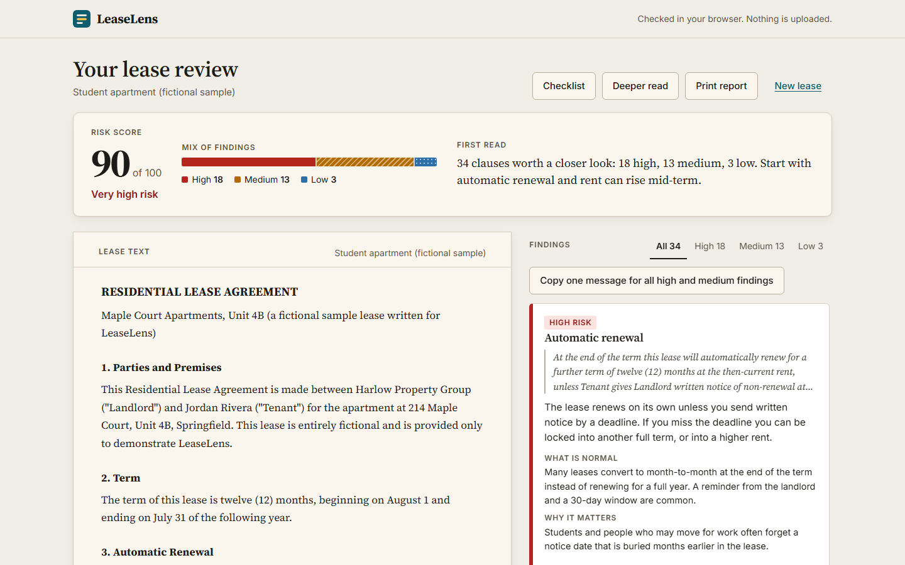
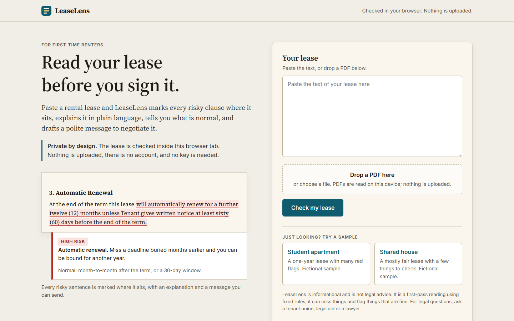
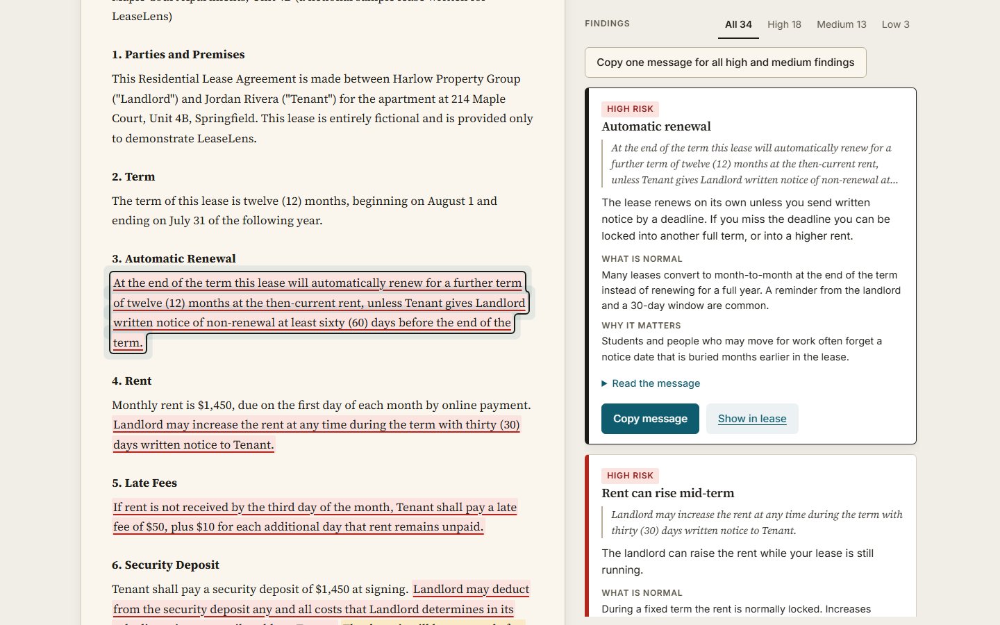
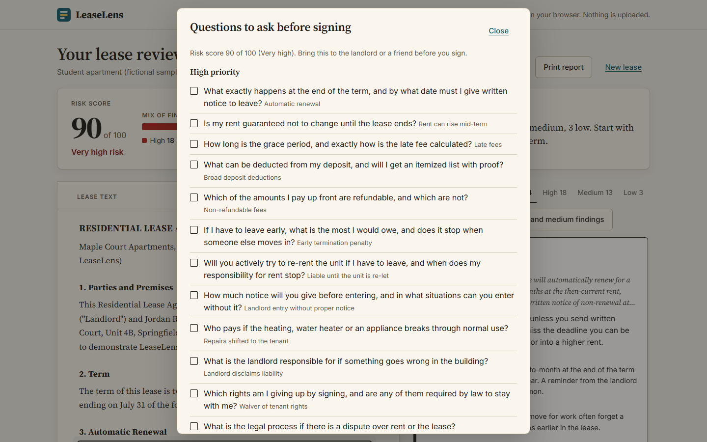
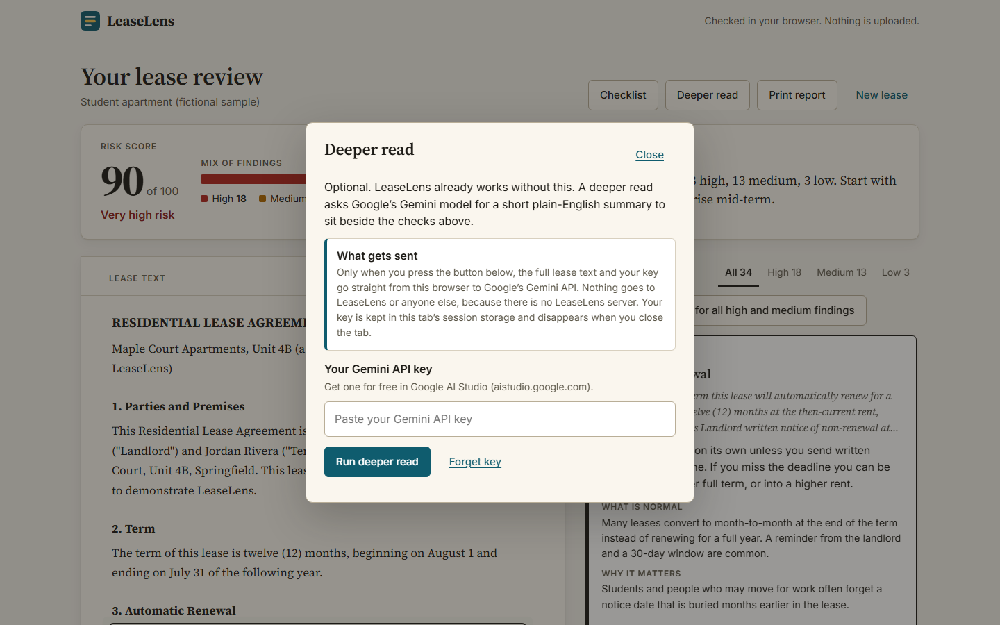
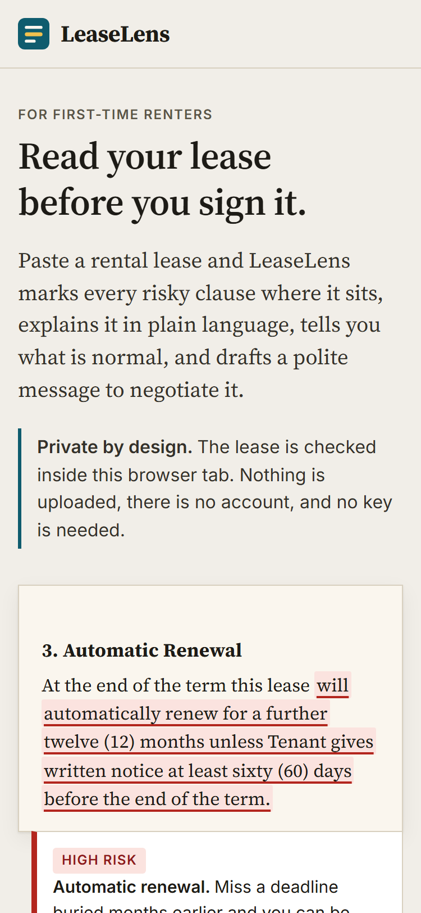
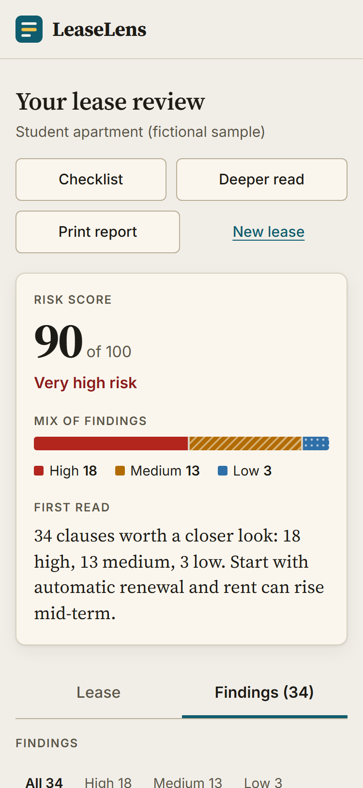

# LeaseLens

**Read your lease before you sign it.** LeaseLens is a private, in-browser lease reader. Paste a residential rental lease (or drop a PDF) and it highlights every risky clause where it sits, colour-coded by risk, with a plain-language explanation, what is normal, and a polite message you can send to negotiate it.

Built for the Devpost [Build With AI: Basics](https://learn-ai-basics.devpost.com) hackathon, using the Devpost Learn skill pack with Claude Code as the coding agent.

> Informational only. LeaseLens is not legal advice, and it is a first-pass reading using fixed rules: it can miss things and flag things that are fine.



## Who it is for

First-time renters: a student moving off campus, a young worker signing a first lease in a new city. Leases are long, dense and handed over with a deadline. Most people skim, ask a friend, or paste the whole thing into a chatbot (uploading their name, address and income). LeaseLens gives a careful first read without any of that.

## What it does

- **Highlights in place.** The lease stays on the page like paper; each risky sentence is marked right where it is. Risk is shown by colour *and* underline style (solid, dashed, dotted) *and* a text label, so it never relies on colour alone.
- **Explains each clause.** A card per finding: what the clause means for you, what is normal in a fair lease, why it matters.
- **Drafts the negotiation.** A polite, specific message per clause with one-click copy, plus a single combined message for every high and medium finding.
- **Scores and summarizes.** A 0 to 100 risk score, a mix-of-findings bar, and a one-sentence first read.
- **Checklist.** "Questions to ask before signing", printable or downloadable as Markdown.
- **Two fictional sample leases** so you can see the result in five seconds.
- **Optional Deeper read.** Bring your own Gemini API key for an AI summary beside the checks. The app is fully useful without it.

### 26 clause types

Automatic renewal; early termination penalty; liable until the unit is re-let; holdover penalty; long notice to move out; landlord can change the rules; non-refundable fees; broad deposit deductions; no deadline to return the deposit; late fees (including per-day and compounding); mid-term rent increases; move-out cleaning charge; landlord entry without proper notice; lockout or seizure of belongings; guest limits; subletting or assignment ban; repairs shifted to the tenant; joint and several liability; waiver of tenant rights; one-sided attorney fees; landlord liability waiver and indemnity; mold and pest disclaimers; mandatory renters insurance; pet fees or restrictions; unclear utilities and charges; noise and parking fines.

Every rule has a positive and a negative unit test (`tests/rules.test.ts`).

## Privacy

- The analysis runs **100% in your browser** with a deterministic clause engine (patterns plus structure rules). There is no backend, no account, no analytics.
- The lease text is never stored or sent anywhere. Closing the tab forgets it.
- PDFs are read on your device with [pdf.js](https://mozilla.github.io/pdf.js/). It works offline once the page has loaded.
- The only network request the app can make is the optional **Deeper read**: only when you press the button, your lease text and your own Gemini key go straight to Google's API (`generativelanguage.googleapis.com`). The key is kept in `sessionStorage` and disappears when the tab closes; "Forget key" clears it immediately.
- `npm run e2e` verifies there are no external requests besides Google Fonts, and no non-GET requests, during a full session.

## Run it

Needs Node 20 or newer.

```bash
npm install
npm run dev            # development at http://localhost:5173
npm test               # unit tests
npm run build          # type-check and production build into dist/
npx vite preview       # serve the production build locally
```

The build uses a relative base path, so `dist/` can be published as is on GitHub Pages or any static host.

Other scripts: `npm run e2e` (Playwright checks against the build), `npm run screenshots` (README screenshots), `npm run capture` (records the demo video to `submission/demo.webm`).

## How it works

```
text / PDF  ->  reflow + sentence splitter (with offsets)  ->  26 rules  ->  findings
                                                                   |
        score + summary  <-  merge findings per sentence  <--------+
                |
   lease view (<mark> per risky sentence)  <->  finding cards  ->  copy message / checklist
```

- `src/engine/` is pure TypeScript with no DOM: `text.ts` (splitter, numbers), `rules/` (five files, one per group), `analyze.ts`, `score.ts`, `messages.ts`, `checklist.ts`.
- `src/ui/` builds the interface with a tiny element helper that always uses `textContent`, so lease text can never become markup.
- `src/pdf/` extracts and reflows PDF text. `src/ai/gemini.ts` is the one optional network call.
- Design: warm paper for the lease, one accent colour, risk colours checked for WCAG AA contrast by a unit test (`tests/design.test.ts`), responsive down to 375 px, keyboard accessible, print styles.

## Built with the Learn skill pack

This repository was started from an empty folder during the submission period. The planning documents were produced by running the Devpost Learn skills in order (`npx skills add challengepost/learn-ai-basics --all -y`):

| Step | Output |
| --- | --- |
| `1-start` | `devpost/learner-profile.md` (kept out of git) |
| `2-scope` | [`scope.md`](scope.md) |
| `3-prd` | [`prd.md`](prd.md) |
| `4-spec` | [`spec.md`](spec.md) |
| `5-build` | [`devpost/checklist.md`](devpost/checklist.md), the code, the tests, [`devpost/app-map.html`](devpost/app-map.html) |
| `6-ship` | demo video and submission notes in [`submission/`](submission) |

The canonical copies of the planning documents live in `devpost/`; `scope.md`, `prd.md` and `spec.md` at the repository root are identical copies.

## Screenshots

| | |
| --- | --- |
|  |  |
|  |  |
|  |  |

## Limits

- Rules look for known patterns; unusual wording can be missed and some flags will not apply to you.
- "What is normal" is general practice, not the law of your location. Tenant rules vary a lot by place; check with a tenant union, legal aid or a lawyer.
- Scanned (image-only) PDFs are not read, since there is no OCR; paste the text instead.
- English-language residential leases only.

## License

MIT. See [LICENSE](LICENSE). The two sample leases are fictional and written for this project.
